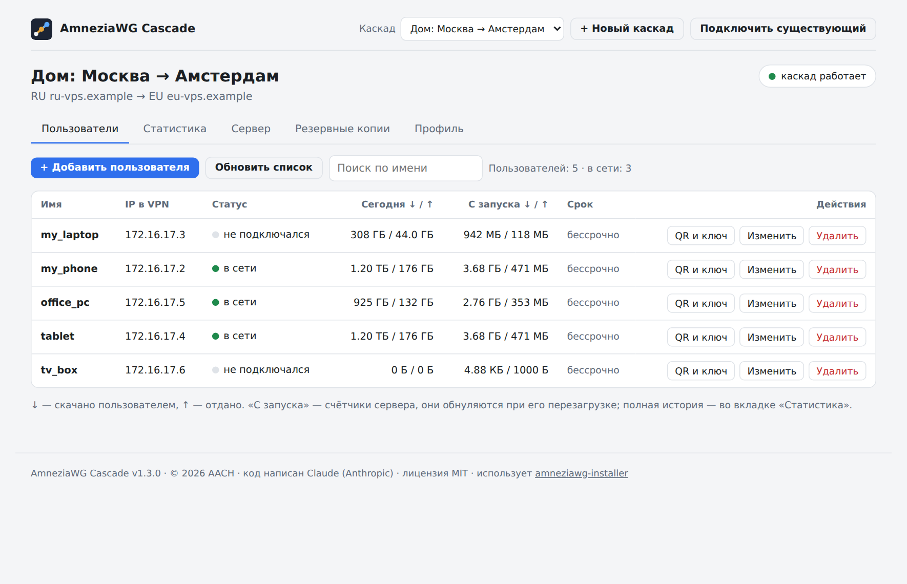
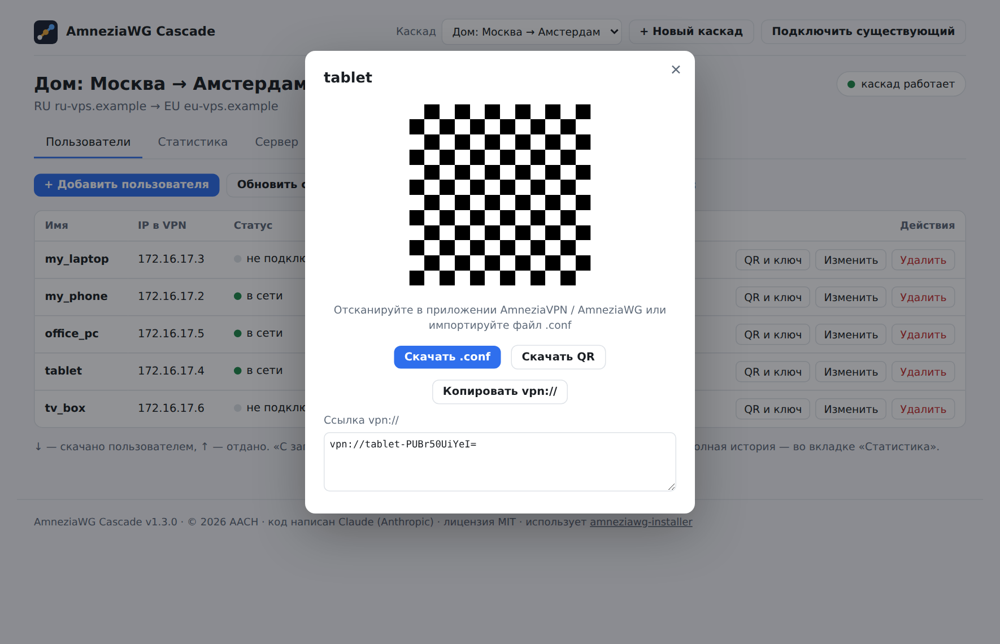
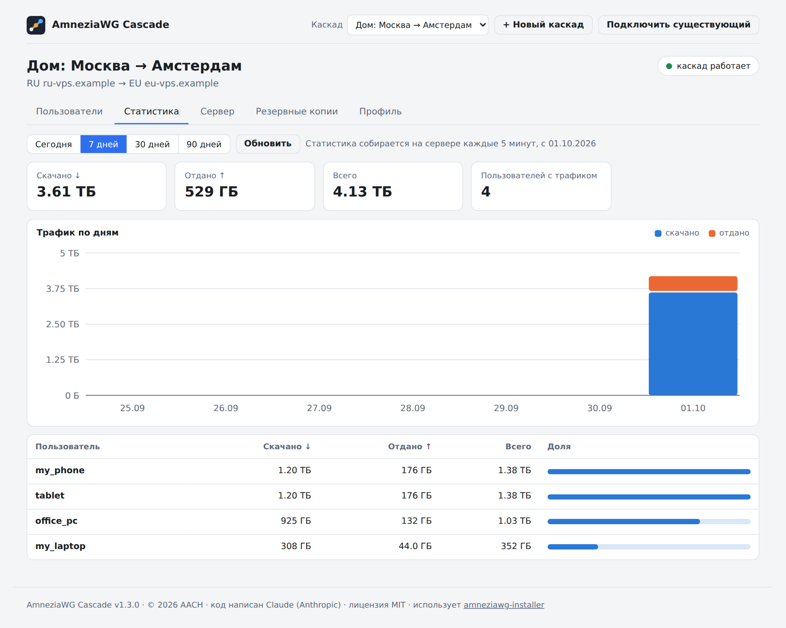
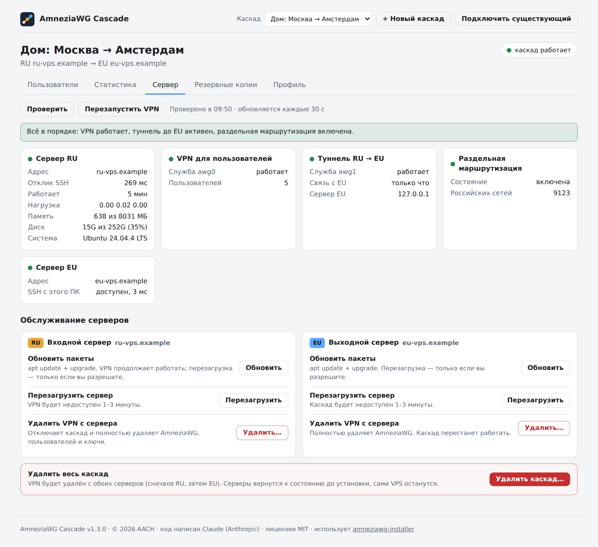
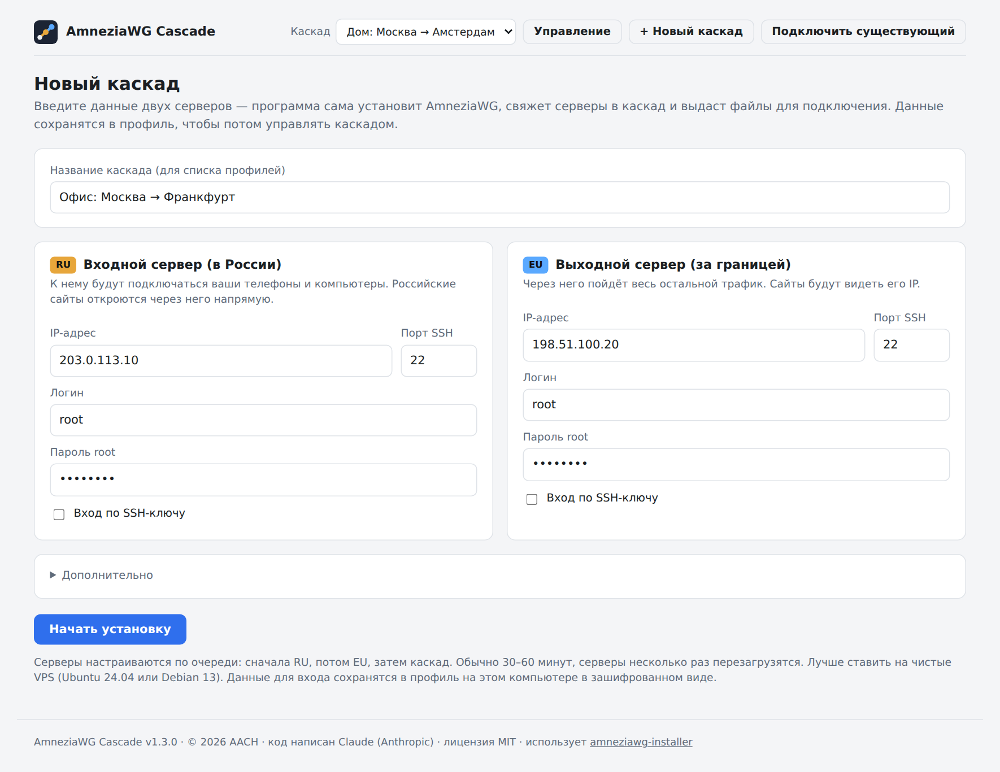

# AmneziaWG Cascade

[English version](README.en.md)

Программа для Windows, которая за один запуск разворачивает **каскадный VPN на AmneziaWG** из двух VPS и затем даёт удобно им управлять — без ручной работы в консоли.

- **Сервер RU** (входной, в России) — к нему подключаются телефоны и компьютеры. Российские сайты открываются через него напрямую, с российским IP.
- **Сервер EU** (выходной, за границей) — через него идёт весь остальной трафик.

Одно подключение на устройстве — и российские, и зарубежные сервисы работают так, как должны.



## Возможности

**Установка**

- Вводите IP и пароль root (или SSH-ключ) двух серверов — остальное программа делает сама:
  1. **RU:** обновление системы → установка AmneziaWG;
  2. **EU:** обновление системы → установка AmneziaWG;
  3. **каскад:** туннель RU → EU, раздельная маршрутизация по списку российских сетей, автозапуск, еженедельное обновление списка, самопроверка.
- Серверы несколько раз перезагружаются — программа ждёт и продолжает сама. Если закрыть её посреди установки, при следующем запуске она продолжит с того же места.
- В конце — QR-коды и файлы `.conf` для подключения.

**Управление**

- **Пользователи:** статус (в сети / когда был), трафик, срок действия; добавление, QR-код и ключ, переименование без смены ключа, перевыпуск ключа, удаление.
- **Статистика:** трафик по дням и по пользователям за 1/7/30/90 дней. Собирается на сервере каждые 5 минут и не теряется при перезагрузках.
- **Сервер:** проверка сервера RU, туннеля до EU, маршрутизации и доступности EU; перезапуск VPN и перезагрузка сервера.
- **Резервные копии** обоих серверов на вашем компьютере и восстановление из них.
- **Профили:** несколько каскадов в одной программе; можно подключить и уже работающий каскад.

| | |
|---|---|
|  |  |
|  |  |

## Требования

- Windows 10 или 11 (интерфейс открывается в окне Microsoft Edge, он есть в системе).
- Два VPS с **Ubuntu 24.04 / 26.04 или Debian 13**, доступ root по SSH, **публичный IPv4** на каждом (не за NAT). Лучше — чистые серверы.
- На серверах должен быть доступ к GitHub (оттуда скачивается установщик AmneziaWG) и к репозиториям пакетов.

## Установка и запуск

1. Скачайте архив из раздела [Releases](../../releases) и распакуйте.
2. Запустите `AmneziaWG-Cascade.exe`. Установка не требуется.
3. Файл без цифровой подписи, поэтому Windows может показать «Windows защитил ваш компьютер» → «Подробнее» → «Выполнить в любом случае». Контрольные суммы файлов — в `SHA256SUMS.txt` релиза; exe собирается из исходников автоматически через GitHub Actions.

Где что хранится:

| Что | Где |
|---|---|
| Профили (пароли и ключи зашифрованы DPAPI) | `%APPDATA%\AmneziaWG-Cascade\profiles.json` |
| Журнал, файлы подключений, резервные копии | `Документы\AmneziaWG-Cascade\` |

## Как это работает

Программа подключается к серверам по SSH и выполняет на них шаги из инструкции [CASCADE.md](https://github.com/bivlked/amneziawg-installer/blob/main/CASCADE.md) проекта [amneziawg-installer](https://github.com/bivlked/amneziawg-installer):

- установщик `install_amneziawg.sh` скачивается с официальных релизов проекта и запускается с `--yes --disallow-ipv6 --route-all --subnet=…`;
- долгие операции (обновление системы, установщик) запускаются на сервере как служба `systemd-run`, программа только следит за их журналом — поэтому обрывы связи и перезагрузки им не мешают;
- для каскада на сервер RU кладётся скрипт [`assets/cascade-setup.sh`](assets/cascade-setup.sh): он создаёт туннель `awg1` к серверу EU и устанавливает скрипт маршрутизации `awg-routing.sh` из CASCADE.md без изменений;
- пользователями программа управляет через штатный `manage_amneziawg.sh`.

Интерфейс — локальная веб-страница: программа слушает только `127.0.0.1`, а каждый запрос защищён случайным токеном, чтобы им не могли управлять другие сайты.

## Безопасность

- Пароли и ключи в профилях шифруются средствами Windows (DPAPI): расшифровать их может только ваша учётная запись на этом компьютере.
- Ключ SSH-сервера запоминается при первом подключении; если он изменится во время установки, программа остановится.
- Резервные копии содержат приватные ключи пользователей VPN — храните их как пароли.
- Сервер RU видит трафик пользователей до отправки в туннель — это точка доверия, держите доступ к нему под контролем.

## Ограничения

- Только IPv4; IPv6 на серверах отключается.
- Трафик делится по IP-адресу назначения, а не по домену: `.ru`-сайт на зарубежном CDN пойдёт через EU. Такие адреса можно добавить в `EXTRA_RU_NETS` в `/root/awg/awg-routing.sh` на сервере RU.
- Часть узлов Google/YouTube стоит на российских IP и пойдёт напрямую.
- Восстановление из копии рассчитано на тот же сервер (например, после переустановки AmneziaWG); перенос на сервер с другим IP потребует перевыпуска клиентских файлов.

## Сборка из исходников

Нужен Go 1.24+.

```bash
go mod tidy
GOOS=windows GOARCH=amd64 go build -trimpath -ldflags "-H=windowsgui -s -w -X main.version=1.2.0" -o AmneziaWG-Cascade.exe .
```

Файл `rsrc_windows_amd64.syso` (иконка и сведения о версии) собран из [`winres/`](winres) командой
`x86_64-w64-mingw32-windres -O coff -o ../rsrc_windows_amd64.syso app.rc` в папке `winres`.

| Файл | Назначение |
|---|---|
| `main.go` | локальный веб-сервер, окно Edge |
| `stages.go`, `job.go` | сценарий установки по шагам |
| `manage.go` | управление каскадом: пользователи, статистика, состояние, копии |
| `profiles.go`, `secret_*.go` | профили и шифрование DPAPI |
| `ssh.go`, `hub.go` | SSH с переподключением, поток событий в интерфейс |
| `assets/` | интерфейс и скрипты, выполняемые на серверах |

## Авторство

Код приложения написан **Claude** — ИИ-моделью компании [Anthropic](https://www.anthropic.com) — по заданию и под руководством **AACH**, который сформулировал требования, тестировал программу на реальных серверах и сопровождает проект.

Схема каскада и скрипт маршрутизации — из проекта [amneziawg-installer](https://github.com/bivlked/amneziawg-installer) (© Ivan Bondarev, MIT). Проект не связан с AmneziaVPN и автором amneziawg-installer.

## Лицензия

[MIT](LICENSE) © 2026 AACH. Сторонние компоненты и их лицензии — в [THIRD_PARTY_NOTICES.md](THIRD_PARTY_NOTICES.md).
